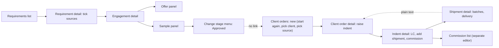

# Current-state audit — TCL Sourcing Platform demo

Audit of the front-end demonstration as it stood **before** the refactoring described in
[REFACTORING_SUMMARY.md](REFACTORING_SUMMARY.md). Line references point to the files as they were at that point (commit
`f7300d9`).

Findings are marked **verified** (seen in the code or by running it) or **suspected** (likely, not proven).

---

## 1. Architecture

| Area | What exists |
|---|---|
| Stack | React 18, TypeScript (strict), Vite 5, Tailwind 3, react-router 6, Zustand 4, Radix primitives, dnd-kit, React Flow, Recharts, sonner. |
| Data | One in-memory "database" in a Zustand store (`src/data/store.ts`), built from a deterministic seed (`src/data/seed.ts`, seed `20261105`, demo date 5 Nov 2026). Lost on reload; "Reset demonstration data" rebuilds it. |
| Access layer | `src/data/api.ts` is the only write path: simulated latency, View Only refusal, audit trail. `src/data/selectors.ts` holds the read models (named after the SQL views in `../dcos/07-database-schema.sql`). `src/data/rules.ts` re-implements the database rules. |
| UI kit | `src/components/ui` — primitives, overlays, form controls, a shared `DataTable` (sort, paging, column menu, CSV export), domain badges, the stage rail. |
| Layout | `src/layout/AppShell.tsx` (rail, top bar, mobile nav, presenter menu), breadcrumbs, command palette, login and splash. |
| Features | One folder per area, each exporting its routes: products, manufacturers, clients, pipeline, orders, insight, admin, dashboard, misc. ~30k lines in total. |
| Specification | `../dcos` holds the glossary, requirements, use cases, sitemap, user flows, schema and the business description the demo was built from. |

**Verified:** there is already a single source of truth for data. Every screen reads the same store, and no orphaned
foreign keys were found in the seed.

---

## 2. Navigation as it was

Fourteen sidebar entries in six groups (`AppShell.tsx` L81–123):

| Group | Entries |
|---|---|
| Overview | Dashboard |
| Register | Products, Manufacturers, Clients |
| Pipeline | Requirements, Engagements, Samples |
| Trade | Client orders, Indents, Shipments, Commission |
| Insight | Relationships, Documents, Reports |
| Administration | Admin |

Reachable but not in the sidebar: `/sources/:id` (a manufacturer's product), `/batches`, `/engagements/:id/peers`,
`/requirements/unsourced`, `/documents/expiring`, the four report pages, the three relationship views and eight admin
pages.

---

## 3. Feature inventory

Classifications: KEEP, MERGE, NEST, SIMPLIFY, QUESTION, REMOVE (none were removed).

| Module | Business purpose | Main actions | Depends on | Problems found | Recommendation |
|---|---|---|---|---|---|
| Dashboard | What needs attention today | Mine/Everyone scope, tile links | `dashboard()` selector | Two lists capped at 8 (`selectors.ts` L757, L761); "molecules" tile counted requirements; ageing threshold hard-coded to 60 (`Dashboard.tsx` L374); tiles link to lists that do not match their number; decorative rather than actionable | SIMPLIFY into an action list |
| Products | Catalogue of molecules, who makes them, who takes them | Search (synonym, CAS), 7 filters, create, edit, discontinue | sources, engagements | Filter grid of 7 controls always open; "Record requirement" did not pass the product | KEEP, simplify filters |
| Manufacturers | Supplier register and TCL's portfolio | Filters, register, status change, add source | sources, engagements, indents | Sites and contacts read-only after creation; commission KPI counted written-off amounts, unlike the client page | KEEP |
| Clients | Demand-side register | Filters, register, sites, contacts, activity | requirements, engagements, orders | "Record client order" did not pass the client; inactive banner promised a reactivation that does not exist | KEEP |
| Sources (`/sources/:id`) | One manufacturer's product: portfolio, filings, prices | Portfolio switch, filings, prices, edit | manufacturer, product | Breadcrumb "Sources" linked to a 404; two edit paths for the same fields | NEST under Products (already not in sidebar) |
| Requirements | Client enquiries | Search, 7 filters + "Unsourced only", create, edit, match to sources | sources, engagements | No progress or next step once engagements exist; requirement status is set by hand and never follows the engagements; unsourced logic duplicated three ways | KEEP, make it the "sourcing request" view |
| Unsourced demand | Molecules TCL cannot supply, ranked | Export | requirements, sources | Own copy of the gap logic | NEST under Requirements |
| Engagements (board) | Every client × source deal by stage | Drag to change stage, 6 filters, table view | rules, stage dialog | Dragging to Offered or a sample stage created **no offer or sample record**; dragging to Approved skipped the "no passed sample" note the detail page asks for | KEEP, add guards |
| Engagement detail | One deal | Change stage, offers, samples, activity | offers, samples, orders | 11 panels and no next step; link to `/orders/:id` was broken (`EngagementDetail.tsx` L417); documents could not be attached; no way to start an order; "Change stage" menu offered stages that need records | SIMPLIFY into a deal workspace |
| Samples | Every sample round across the book | Filters, overdue toggle | samples, engagements | Read-only copy of the engagement's sample panel with its own joins; `/samples/:id` ignored the id; outcome could be recorded before the sample was even sent (`SamplePanel.tsx` L267) | NEST under Engagements |
| Client orders | What the client wants, from which source | Filters, create, raise indents | indents, shipments | Detail listed indents only, not shipments, deliveries or commission; lines did not show the engagement they came from; order status never left OPEN | KEEP, connect the chain |
| Indents | Orders placed on manufacturers for a client | Filters, LC, shipments, commission edit | orders, shipments, commission | No link back to the client order (computed but unused, `IndentDetail.tsx` L90); total labelled USD regardless of currency; free-form commission editor | MERGE under Orders (tab) |
| Shipments | Goods despatched, cleared, delivered | Status buttons, batches, deliveries | indents, batches | Could never reach Delivered; "held at customs" offered for any status; client and order shown as plain text | KEEP |
| Batches | Manufacturer production batches | Filters | shipments | Not in the sidebar or palette; reachable only from a shipment | NEST under Shipments (tab) |
| Commission | TCL's earnings per indent | Invoice, receipt, write-off | indents | Duplicated by the commission report; two editors with different status rules; totals hard-labelled USD | MERGE tracker and report |
| Relationships | Client × product × manufacturer as tree and matrices | Re-root tree, matrix filters | engagements | Per-record views already on product, client and manufacturer pages; only the matrices are genuinely cross-record | NEST under Reports |
| Documents | Certificates and letters | Upload, filters, expiring report | every record | The only place documents could be uploaded; every detail page was read-only | NEST under Reports, add contextual upload |
| Reports | Register, pipeline, funnel, commission | Group, export | selectors | Commission report and tracker disagreed on monthly attribution (`CommissionReport.tsx` L90 vs `CommissionTracker.tsx` L113) | KEEP |
| Admin | Users, roles, reference data, logs | User changes; the rest read-only | store | Write-only tiles shown to View Only users; "Not permitted" page claimed a security-log entry that was never written | KEEP, move out of the main groups |
| Command palette | Jump to records and screens | Search | `search()` | cmdk's own filter hid synonym-only matches; Samples, Reports and Batches missing | KEEP, fix |

---

## 4. How a sourcing deal moved through the screens

**Verified gaps:**

1. After approval there was no way forward from the engagement. The user had to open the client order form, choose the
   client again and find the source again. Its `?client=` parameter was never passed.
2. The engagement's only link to its orders was broken.
3. The client order did not show its shipments, deliveries or commission, so "has it arrived and are we paid?" took
   four screens.
4. The indent had no link back to its order. The shipment showed the order as text.
5. No screen said what to do next on a deal.
6. Order and indent statuses stayed OPEN even when fully delivered, so lists contradicted their own quantity columns.

---

## 5. UX problems

- **Too many top-level entries** for a non-technical audience. Several (Samples, Indents, Batches, Relationships,
  Documents) are views of records owned elsewhere.
- **Entity-first labels** — "Engagement" and "Indent" are correct trade terms (see §7), but nothing on screen explained
  them.
- **Filter overload** — the same 4-column grid of 5–8 selects was copied into 15 list pages and always fully open.
  The same debounced-search code was repeated in 10.
- **No next action** on the requirement, engagement or order pages.
- **Integrity holes a demo can fall into** — dragging a card to Offered left an engagement "Offered" with no offer.
- **Dashboard tiles** described the business but did not lead to the work.

---

## 6. Code-level duplication

| Duplication | Where | Kind |
|---|---|---|
| Filter grid and debounced search | 15 list pages | UI boilerplate — consolidated into `FilterBar` and `useUrlSearch` |
| Unsourced gap logic | `RequirementDetail.exclusionReason`, `UnsourcedDemand`, dashboard | Business logic — consolidated into `sourcingGap` |
| Sample round fields and overdue rule | `SamplePanel`, `SampleTracker` | Two views of one record (justified: one edits, one monitors) |
| Commission editing | `IndentDetail` dialog, `CommissionTracker` menu | Business logic with different rules — consolidated into `CommissionActions` |
| Commission totals and monthly chart | `CommissionTracker`, `CommissionReport` | Duplicate page — merged into one section with two tabs |
| Order, shipment and commission status badges | `orders/shared.tsx`, inline copies in `ManufacturerDetail` | UI — moved to `components/ui/records.tsx` |
| Approval checks | `EngagementDetail` only, missing on the board | Logic gap — consolidated into `approvalContext` |

The detail pages for product, client and manufacturer legitimately repeat the triangle from three directions. That was
left as it is.

---

## 7. Terminology

| Term in the demo | Where it comes from | Meaning in the code | Assessment |
|---|---|---|---|
| Engagement | Spec glossary (`dcos/00` L143): "the core record of the system" | One client × one manufacturer-product, moving through 7 stages plus On hold, Rejected, Discontinued | Correct but opaque to newcomers. Kept, with "client × supplier deal" as a plain-language subtitle |
| Indent | Spec glossary (`dcos/00` L159), confirmed by Q1 (5 Nov) | The order TCL places on a manufacturer on behalf of one named client; carries the LC and the commission | The brief's "Intents" is this term. Kept, with "orders placed on manufacturers" as a subtitle |
| Source | Spec (`dcos/00` L138–140) | A manufacturer's product, e.g. Budesonide-by-Biocon | Kept |
| Relationships | Sitemap section, not a glossary term | Tree and matrices over engagements | Moved under Reports as "Relationship explorer" |
| Commission | Spec (`dcos/00` L160) | TCL's earnings on an indent, receivable from the client; basis may be "to be decided" | Kept; when it becomes payable is open (see the clarification questions) |

---

## 8. Seed data

**Verified** by running the generator:

- 6 indents were dated before their client order.
- 6 shipments left before their indent.
- One shipment was cleared after the demonstration date.
- Every order and indent was OPEN.
- "Fulfilled" requirements had engagements still at Sample sent.
- A Prospect client had commercial business.
- Only three stories ran end to end.
- The spec's flagship example (Square buying Budesonide from Biocon and Wockhardt, one order split across both) did not
  exist, although a security-log entry referred to it.
