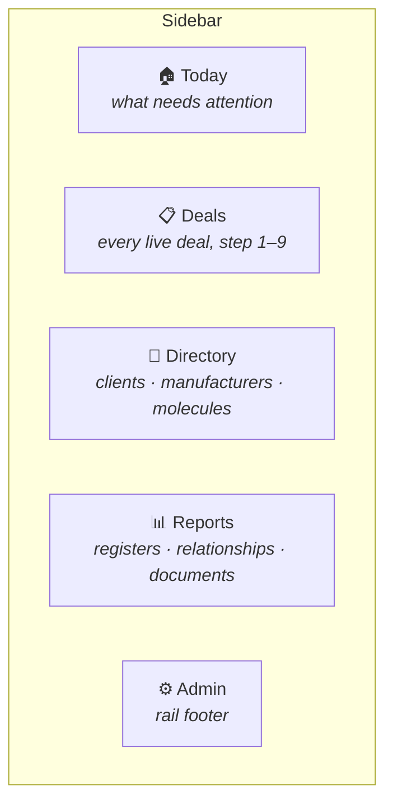
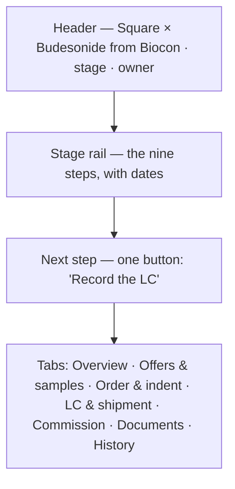

# Reducing the overwhelm — information architecture plan

**Status:** proposal for approval. Nothing here deletes a page, a feature, a button or a mechanism.
Everything stays reachable. What changes is *where it sits* and *how much of it you meet at once*.

Companion to [CURRENT_STATE_AUDIT.md](CURRENT_STATE_AUDIT.md) and
[PROPOSED_PRODUCT_STRUCTURE.md](PROPOSED_PRODUCT_STRUCTURE.md), which took the sidebar from 14 entries to 10.
That was a trim. This is the structural fix.

---

## 1. The business, restated in one page

Techstream Ltd (TCL) is an **indenting house** for pharmaceutical raw materials.

Bangladeshi pharma companies — Square, ACI, Incepta, Renata, Beximco, Healthcare, Ibn Sina — make finished
medicines. They do not make the **API** (the active chemical) or the excipients. Those come from plants in India,
China and Europe: Biocon, Wockhardt, Bajaj Healthcare, Concord Biotech, Moehs Iberica.

TCL stands between them.

```
Foreign API manufacturers  ──►  TCL (Techstream)  ──►  Bangladeshi pharma companies
      (supply side)              (the mediator)              (demand side)
```

**TCL never owns the goods.** No purchase price, no selling price, no margin on material, no warehouse. The client
pays the manufacturer directly, normally by letter of credit. TCL agrees the deal for both sides, places the order
on the manufacturer in the client's name (the **indent**), and earns a **commission from the client**.

The job is long and paper-heavy because the buyer cannot simply order: they must see the filings (DMF, CEP, GMP),
test a free sample in their own lab, and formally approve that one plant — six months to two years — and they
usually want two approved sources for anything important.

### What the software is

**A recording system for TCL's own staff.** It automates nothing. It fetches nothing from email, from banks, from
forwarders. An employee learns something by phone, by email, by visit — and types it in. Clients and manufacturers
never log in. Two access levels only: Full Access and View Only.

Its value is that the knowledge becomes **queryable from any direction** — client × molecule × manufacturer ×
batch × stage × date — which a spreadsheet grid cannot do, and which today lives in people's heads and walks out
when they leave.

### The one chain the employee actually walks

Everything in the system is a stage of a single chain. This is the user's own description of the job, and it is
exactly right:

```mermaid
flowchart LR
  A["1· Client asks for a molecule<br/>(requirement)"]
  B["2· Is there a source?<br/>(check manufacturers)"]
  C["3· Offer the source<br/>(price, FOB/CFR, filings)"]
  D["4· Sample: taken from manufacturer,<br/>given to client, evaluated"]
  E["5· Client approves the source"]
  F["6· Client orders → TCL indents<br/>on the manufacturer"]
  G["7· LC arrives (seen externally):<br/>expiry date, latest shipment date"]
  H["8· Shipment: before or after LC expiry,<br/>customs, delivery, batches"]
  I["9· Commission: agreed, invoiced, received"]
  A --> B --> C --> D --> E --> F --> G --> H --> I
```



Nine steps. One deal. **That is the whole product.**

---

## 2. The diagnosis

> The features are necessary. The structure is what hurts.

### 2.1 The system is organised by record type, the employee thinks in deals

The sidebar has one entry per database table: Requirements, Engagements, Orders, Shipments, Commission,
Products, Manufacturers, Clients, Reports, Product 2.0, Admin. But Requirements, Engagements, Samples, Orders,
Indents, Shipments, Batches and Commission are **not eight subjects**. They are **eight stages of step 1 through 9
above** — slices through one pipeline, presented as if they were peers.

So the employee, who has one deal in their head, is shown eleven doors and has to work out which one their deal is
behind today. That is the overwhelm. It is not the number of features; it is that the navigation models the
*schema* instead of the *job*.

### 2.2 There are two complete products in the repository

`src/features/product2/` is a second, parallel implementation of the same business: its own types
(`types.ts`), its own store (`store.ts`, 794 lines), its own seed, its own workflow engine (`workflow.ts`),
its own dialogs (`sourcingDialogs.tsx`, `tradeDialogs.tsx`), its own list, detail, orders and commission pages —
roughly 4,600 lines, deliberately independent of `src/data/`.

It covers the identical chain: API product → sourcing record → sample → trade order → PI/indent → LC → shipment →
commission. It is in the sidebar as a thirteenth destination called "Product 2.0".

**This is the single largest contributor to the feeling of too much.** The user is being shown two applications and
asked to pick. It also doubles every future change.

The irony: **Product 2.0 has the better shape.** `P2Detail.tsx` is one page with three tabs — Sourcing, Trade
orders, Overview — and you drill from the molecule into the deal into the order. That drill-down is what the main
app is missing. The main app has the better data layer: `rules.ts`, `api.ts` with the audit trail and View Only
refusal, `selectors.ts` with the `nextStepFor` engine.

### 2.3 Every page shows everything it could, at full volume

- **15 list pages** each open with a 4-column grid of 5–8 `Select` filters, always expanded, before you have
  typed anything.
- **The dashboard** leads with six competing blocks: Needs attention, four KPI tiles, pipeline by stage, commission,
  unsourced molecules, demonstration stories.
- **`ClientDetail.tsx` is 1,647 lines**; `ShipmentDetail` 1,240; `SourceDetail` 1,137; `ManufacturerDetail` 1,080.
  These are not complex records — they are every panel the record could have, stacked vertically.
- **The top bar** carries breadcrumbs, search, a View-only badge, notifications, and a user menu containing a role
  switch, a simulated-latency control and a rule-notes toggle. Three of those are presenter kit, permanently on
  screen for an employee who will never use them.
- **Admin is nine pages** — Users, Roles, Reference data, Workflow config, Notifications, Audit, Duplicates,
  Health, Home — for a system whose entire access model is two roles that cannot be edited.

### 2.4 The same fact appears in several places with no hierarchy between them

| Shown here | And again here | And again here |
|---|---|---|
| Unsourced molecules | `/requirements/unsourced` | Dashboard panel | `RequirementDetail` exclusion reason |
| Samples | Engagement's sample panel | `/samples` tracker | — |
| Commission | `/commissions` tracker | `/commissions/analysis` | Indent detail dialog |
| Batches | Inside a shipment | `/batches` list | — |
| Indents | Inside a client order | `/indents` list | — |
| The client×product×manufacturer triangle | Product page | Client page | Manufacturer page, plus `/relationships` tree and two matrices |

Each of these *is* needed — but one of them is the home and the others are **questions asked of it**. Today they are
presented as equals, so the employee cannot tell which one to trust or where to type.

### 2.5 Counts as they stand

| | Now |
|---|---|
| Sidebar entries | 12 in 6 groups, plus Admin |
| Second-level tabs | 13 across 6 sections, plus 3 in Product 2.0 |
| Routed screens | ~51 route declarations, ~60 distinct screens |
| Top-level concepts a new employee must learn before clicking | requirement, engagement, source, indent, batch, commission, "Product 2.0" |

---

## 3. The principles

Five rules. Everything in section 4 follows from them.

1. **The sidebar is for places you start work, not for questions you ask.**
   A filtered view of something already in the sidebar is a question. Questions live on the dashboard, in search,
   and as filters on the list they belong to.

2. **One deal, one page, carried forward.**
   The nine steps happen to one deal. They belong on one record that shows where it is and what to do next — not
   on nine pages the user must find.

3. **Depth before breadth.**
   Sidebar (4) → section tabs (≤3) → record page → in-page tabs (≤5) → dialog. Five levels is plenty for sixty
   screens; four doors at the top is enough for any of them.

4. **A page opens quiet and reveals on demand.**
   Search plus the two filters that matter. Everything else behind "More filters". A record opens with its summary
   and its next action; its panels are tabs, not a stack.

5. **Nothing is removed. Things move down a level.**
   Every page keeps its URL, its breadcrumb, its command-palette entry and its deep link. If you know where
   something is, it is still there.

---

## 4. The proposed structure

### 4.1 The sidebar: four entries plus Admin



| Entry | What it is | What it absorbs |
|---|---|---|
| **Today** | The morning screen. One list: what is waiting on you, grouped by the action needed. Nothing else above the fold. | Dashboard |
| **Deals** | Every live piece of business, one row each, with its stage. This is where work happens. | Requirements, Engagements, Samples, Client orders, Indents, Shipments, Batches, Commission, **and Product 2.0** |
| **Directory** | Three tabs: Clients · Manufacturers · Molecules. Look things up; start a deal from any of them. | Products, Manufacturers, Clients, Sources |
| **Reports** | Read and export. Registers, relationship explorer, document library, funnel, commission analysis. | Reports, Relationships, Documents |
| **Admin** | Rail footer, away from the daily work. One page, tabs inside. | The nine admin pages |

**Twelve entries become four.** The employee's first decision is: *am I doing work (Deals), looking something up
(Directory), or reporting (Reports)?* Those are the only three things they ever do.

### 4.2 Deals: one list, one workspace

The deal list is a table with a **stage filter**, not eight separate pages:

| Stage filter | Replaces today's page |
|---|---|
| Enquiry — no source yet | `/requirements/unsourced` |
| Enquiry — sources identified | `/requirements` |
| Offered · Sample out · Under evaluation | `/engagements`, `/samples` |
| Approved — not yet ordered | board column |
| Ordered — indent placed | `/client-orders`, `/indents` |
| LC open · Shipped · In customs · Delivered | `/shipments`, `/batches` |
| Commission due · Invoiced · Received | `/commissions` |

Each of those is one click on a filter chip instead of one entry in the sidebar. The board view
(`EngagementBoard`) stays as a view toggle on the same list.

The **deal workspace** is the engagement page, already built with a stage rail and a next-step card
(`nextStepFor` in `selectors.ts`). It gains the trade half, so one page carries all nine steps:



Six or seven tabs on one record, instead of eight destinations in the sidebar.

### 4.3 Two concepts collapse into one in the user's head

**Requirement and engagement stay as separate records in the database. They stop being separate destinations.**

A requirement with sources picked *is* a set of deals. Show it that way: the requirement is the deal's first step,
and the engagements are the sources being tried, listed inside it. The employee learns *one* word — "deal" — not
two. The schema does not change; `RequirementDetail` becomes the step-1 view of the deal rather than its own
branch of the sidebar.

Same for "indent": it is not a destination, it is the **order tab** of a deal. Same for "batch": the **shipment
tab**. The trade words stay on screen as labels and subtitles, because they are the correct words and the staff use
them — they just stop being navigation.

### 4.4 Product 2.0 — decided: it replaces the Products register

**Decision (TCL, 18 Nov 2026): Product 2.0 is the molecule register. The earlier Products tab is retired by it.**

This is narrower than either option originally put: Product 2.0 does not replace the whole application, and the
main app's Deals chain is not retired. Product 2.0 becomes the **Molecules** entry inside Directory, and the
Products catalogue steps back behind it.

| | Before | After |
|---|---|---|
| Sidebar entry "Products" | `/products` — `ProductList` | gone; Directory → **Molecules** |
| Sidebar entry "Product 2.0" | `/product-2` | gone as a top-level door; it *is* Molecules |
| `/products` | the catalogue | redirects to `/product-2` |
| `/products/all` | — | the earlier catalogue, still working, out of the nav |
| `/products/:id` | molecule record | **unchanged** — a dozen pages link to it |

#### What still has to happen, and why it is not in this step

Product 2.0 keeps its own store (`features/product2/store.ts`), its own seed and its own ids, deliberately
independent of `src/data`. So `/products/:id` — linked from orders, indents, shipments, batches, requirements,
unsourced demand, peers, duplicate review and source detail — **cannot** yet resolve to a Product 2.0 record.

Both registers therefore exist for now: Product 2.0 is what you navigate to, the catalogue is what those deep
links still open. The two seeds already agree on **CAS numbers for five of the eight** molecules Product 2.0
carries (Rosuvastatin Calcium, Metformin HCl, Cefixime Trihydrate, Montelukast Sodium, Empagliflozin), so CAS is
the natural join key when the stores are reconciled. The remaining three (Esomeprazole — a different salt form,
Levocetirizine, Ticagrelor) need a decision per molecule.

That reconciliation is step 5. Until it lands, the duplication is **declared rather than hidden**: the catalogue
page is titled "Molecule catalogue" and says in its subtitle that Product 2.0 is the live register and why this
one is still here.

### 4.5 Quiet pages

| Change | Where | Effect |
|---|---|---|
| Filters collapse to search + 2 chips + "More filters" | `FilterBar`, 15 list pages | A list opens with a list on it, not a control panel |
| Record panels become tabs | `ClientDetail` (1,647 L), `ShipmentDetail`, `SourceDetail`, `ManufacturerDetail` | One screen of content instead of ten stacked panels |
| Dashboard leads with "Needs attention" alone; KPIs, pipeline, commission and unsourced move below the fold or behind a "Numbers" tab | `Dashboard.tsx` | One question answered on arrival: *what do I do today?* |
| Presenter controls (role switch, latency, rule notes) move behind a single "Demo" item in the user menu | `AppShell.tsx` top bar | The top bar carries breadcrumbs, search, notifications, you |
| Admin's nine pages become one page with tabs | `features/admin/` | Admin stops looking like a second application |
| `/relationships` tree and matrices keep their place in Reports; the per-record triangle on Product/Client/Manufacturer pages stays as the primary | `insight/` | One home per fact, the rest clearly secondary |

### 4.6 After

| | Now | Proposed |
|---|---|---|
| Sidebar entries | 12 + Admin | **4 + Admin** |
| Top-level concepts to learn | 7 | **3** — deal, directory entry, report |
| Screens to walk one deal end to end | 8 | **1** (plus dialogs) — step 4 |
| Molecule registers | 2 | **1** — step 5 |
| Pages removed | — | **0** |
| URLs broken | — | **0** |

---

## 5. Sequence

Each step is independently shippable and independently revertible.

| # | Step | Risk | State |
|---|---|---|---|
| 1 | Sidebar to 4 entries; Product 2.0 becomes Directory → Molecules; everything else reachable by section tabs, sub tabs and the command palette | low — navigation only | **Done** — see §6 |
| 2 | Quiet the pages: collapse filters, tab the four giant detail pages, lead the dashboard with one list | low | next |
| 3 | Deals list: merge the eight stage pages into one list with stage filters, keeping every URL as a preset | medium | after 2 |
| 4 | Deal workspace: extend the engagement page through the trade half (order, LC, shipment, commission) | medium | after 3 |
| 5 | Reconcile the Product 2.0 and main stores on CAS, so `/products/:id` resolves to a Product 2.0 record and the earlier catalogue can retire | high | after 4 |

---

## 6. Step 1, as built

| Change | File |
|---|---|
| Sidebar: 12 grouped entries → 4 flat entries (Today · Deals · Directory · Reports) + Admin in the footer | `layout/AppShell.tsx` |
| Mobile: bottom bar carries all five; the "More" sheet is gone, because there is nothing left to put in it | `layout/AppShell.tsx` |
| Two-level section nav — section tabs for *where in the chain*, pill sub tabs for *which view* | `layout/sections.tsx` |
| Deals tabs run in workflow order: Requirements → Engagements → Orders → Shipments → Commission | `layout/sections.tsx` |
| Directory tabs: Molecules · Manufacturers · Clients, added to the three register pages | `layout/sections.tsx`, the three lists |
| Product 2.0 retitled as the Molecules register; its module tabs become the Directory's sub tabs | `features/product2/` |
| `/products` → `/product-2`; catalogue preserved at `/products/all`; `/products/:id` untouched | `features/products/routes.tsx` |
| Breadcrumbs name the door: "Home › Deals › Shipments" | `layout/Breadcrumbs.tsx` |
| Command palette gains every destination that left the sidebar | `layout/CommandPalette.tsx` |

Verified by `npm run build` (clean, `noUnusedLocals` on) and `npm run shots` across 54 routes at three widths:
**162 screenshots, 0 console errors, 0 horizontal overflows, 0 failed routes.**

---

## 7. Still open

| # | Question | Why it matters |
|---|---|---|
| 1 | Do staff say **"deal"**, or something else, for one client considering one manufacturer's material? | §4.3 puts that word on the main sidebar entry. (Open as T1 in [CLIENT_CLARIFICATION_QUESTIONS.md](CLIENT_CLARIFICATION_QUESTIONS.md).) |
| 2 | Is **every deal started by a recorded client requirement**, or do some start from a manufacturer offering material? | If some start from the supply side, Deals needs a second entry point from Directory → Manufacturer. (Open as R1.) |
| 3 | Does a deal ever **split** — one requirement, two manufacturers, two LCs, two shipments — in a way the employee thinks of as two deals? | Decides whether the deal list rows are per requirement or per client×source. The data supports both. |
| 4 | For the three molecules whose CAS numbers differ between the two registers (Esomeprazole, Levocetirizine, Ticagrelor), which record is correct? | Blocks step 5. |
