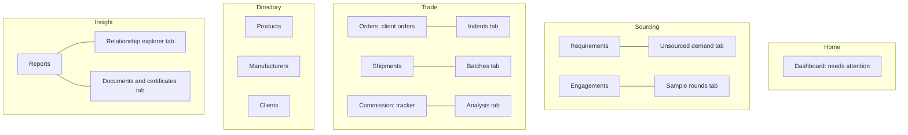
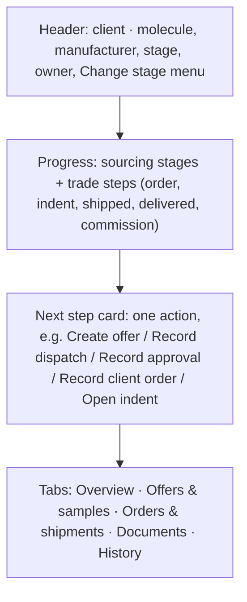
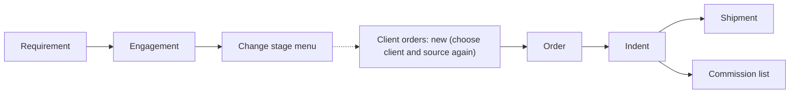
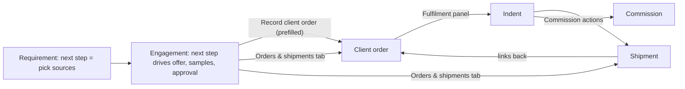

# Proposed product structure — TCL Sourcing Platform demo

The structure now implemented in the demo, and why. Everything here is a **proposal for client discussion**: the
business flows are inferred from the specification in `../dcos` and the existing demo, not confirmed by TCL. Open
points are collected in [CLIENT_CLARIFICATION_QUESTIONS.md](CLIENT_CLARIFICATION_QUESTIONS.md).

---

## 1. Principle

The business has one core flow and three registers that support it:

> A client asks for a molecule → TCL offers one or more sources it represents → the client tests samples and approves a
> source → the client orders → TCL places an indent on the manufacturer → goods ship and are delivered → the client pays
> TCL its commission.

The demo is organised around that flow. The deal (an **engagement**: one client × one manufacturer's product) is the
workspace where a person sees where things stand and what to do next. The registers (products, manufacturers, clients)
stay as co-equal entry points, as the specification requires. They are where you look things up, not where the work
moves forward.

---

## 2. Navigation

| | Before | After |
|---|---|---|
| Sidebar entries | 14 in 6 groups | 10 in 4 groups, plus Admin in the rail footer |
| Second level | none (separate pages) | tabs under the section heading, each with its own URL |
| URLs | — | unchanged, so bookmarks, breadcrumbs, the palette and the scripts still work. Only `/reports/commission` now redirects to `/commissions/analysis` |

Each sidebar entry has a one-line tooltip in plain language, such as "Client × supplier deals: offers, samples,
approval".

---

## 3. Decisions by module

| Module | Decision | Reasoning |
|---|---|---|
| Dashboard | **SIMPLIFY** | Rebuilt around a *Needs attention* list grouped by the action needed. Every item opens the record where the action is taken. Pipeline and commission remain as context. |
| Requirements | **KEEP**, as the sourcing request | Next-step card (pick sources, find a source, or follow the engagements); each engagement shown with compact progress and its own next step. |
| Unsourced demand | **NEST** under Requirements | It is a filtered view of requirements. |
| Engagements | **KEEP**, as the deal workspace | Progress through sourcing *and* trade, one suggested next step whose button opens the right dialog, and tabs for detail. |
| Samples | **NEST** under Engagements | Samples belong to an engagement. The cross-book list stays for chasing overdue rounds. |
| Client orders + Indents | **MERGE** into Orders (two tabs) | Two sides of one order: what the client wants, and what TCL placed on each manufacturer. |
| Shipments + Batches | **MERGE** into Shipments (two tabs) | A batch is only ever met through a shipment. |
| Commission tracker + report | **MERGE** into Commission (two tabs) | Same records, same totals. One earned-month rule, one set of actions. |
| Relationships | **NEST** under Reports | Each record page already shows its side of the triangle; the explorer is for comparing many at once. |
| Documents | **NEST** under Reports, plus contextual upload | Documents are attached where they belong (engagement, order, indent, shipment); the library remains for search and expiry. |
| Products, Manufacturers, Clients | **KEEP** | Co-equal entry points (spec `04-sitemap.md` L33). |
| Sources, Batches, Peers | **NEST** | Reached from their parent records, as before. |
| Admin | **KEEP**, moved to the rail footer | Not part of the daily work. |
| Remove | **none** | Nothing was demonstrably redundant once nested. |

---

## 4. The deal workspace (engagement page)

How the next step is worked out (`nextStepFor` in `src/data/selectors.ts`):

| Where the deal is | Suggested action |
|---|---|
| Identified | Create offer (or renew the source price if none is valid) |
| Offered | Request a sample (revise the offer if declined) |
| Sample requested | Record dispatch |
| Sample sent | Record the client's receipt |
| Under evaluation | Record the outcome; after a pass, record the approval; after a fail, raise another round |
| Approved | Record the client order, prefilled with this client and source |
| Commercial | Follow the trade: raise the indent, record the LC, add the shipment, clear customs, record delivery, agree and invoice the commission |
| On hold, rejected, discontinued | Explained, with how to resume or reopen |

The suggestion never overrides the rules. Stages that stand for a record (Offered, Sample requested, Sample sent, Under
evaluation) are reached only by recording that offer or sample. The board refuses a drag into them and offers to open
the engagement instead.

---

## 5. Workflow: before and after

**Before** — eight screens for one deal, and the context lost at approval:

**After** — the deal carries the user forward, and the trade records link both ways:

---

## 6. Status consistency

- **Order, order line, indent and shipment statuses** are derived from what has shipped and been delivered
  (`deriveTradeStatuses` in `src/data/rules.ts`). They update after every shipment or delivery change. A shipment
  becomes Delivered once all its lines are delivered. Statuses a person sets deliberately (draft, on hold, cancelled)
  are left alone.
- **Requirement status** stays manual, as the specification has it. The requirement page shows progress next to it.
  Whether it should follow the engagements is a client question.
- **Commission** moves through *agree terms → invoice → receipt*, or a write-off, through one component. Each action
  is offered only from the status where it makes sense.

---

## 7. Demonstration stories

Six records, one per stage, listed on the dashboard while presenter notes are on (`DEMO_STORIES` in `src/data/seed.ts`):

1. **A new enquiry:** Beximco needs Budesonide. Two represented sources exist and none is engaged yet.
2. **An offer with the client:** Aristopharma, Dextromethorphan from Moehs Iberica.
3. **A sample under evaluation:** Ibn Sina, Ibuprofen from Biocon.
4. **Approved, not yet ordered:** Healthcare, Capecitabine from Bajaj Healthcare.
5. **Goods on the way:** Aristopharma, Dextromethorphan from Bajaj Healthcare.
6. **Delivered and paid, dual sourced:** Square, Budesonide. One order is split 300 kg from Biocon and 200 kg from
   Wockhardt; it is delivered, with commission received from one and invoiced on the other.
